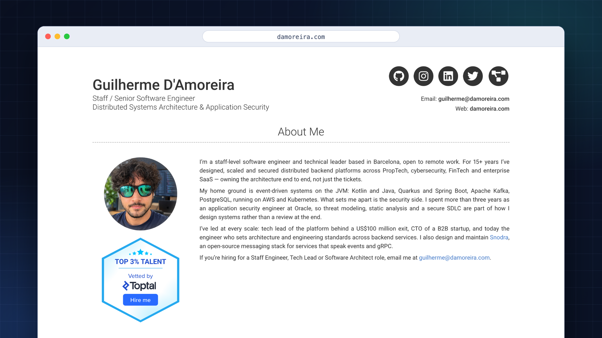

<p align="center">
  <a href="https://damoreira.com"></a>
</p>

<h1 align="center">damoreira.com</h1>

<p align="center">The web CV of Guilherme D'Amoreira, Staff / Senior Software Engineer.</p>

<p align="center">
  <a href="https://damoreira.com"></a>
  <a href="https://github.com/gdamoreira/gdamoreira.github.io/commits/master"></a>
  <a href="LICENSE"></a>
</p>

<p align="center">
  
  
  
  
  
  
</p>

---

## About me

I'm a senior software engineer and technical leader based in Barcelona, open to remote work. For 15+ years I've designed, scaled and secured distributed backend platforms across PropTech, cybersecurity, FinTech and enterprise SaaS.

- **Home ground:** event-driven systems on the JVM with Kotlin, Java, Quarkus, Spring Boot, Apache Kafka and PostgreSQL, on AWS and Kubernetes.
- **Security background:** more than three years as an application security engineer at Oracle (NetSuite), building static analysis tooling and running threat modeling and secure design reviews.
- **Leadership:** tech lead of the 3D production platform behind Decora's US$100 million exit, and CTO of Reticomm for two years.
- **Open source:** creator of [Snodra](https://snodra.damoreira.com), a messaging stack for services that speak events and gRPC.

The full CV is at **[damoreira.com](https://damoreira.com)**. You can also find me on [LinkedIn](https://www.linkedin.com/in/gdamoreira) and [GitHub](https://github.com/gdamoreira), or email [guilherme@damoreira.com](mailto:guilherme@damoreira.com).

---

## How the site is built

The site is a single static page generated by Jekyll and hosted on GitHub Pages. There is no build pipeline in this repository: pushing to `master` triggers the GitHub Pages build.

| Layer | Technology | Notes |
|---|---|---|
| Static site generator | [Jekyll](https://jekyllrb.com) | Built by GitHub Pages through the `github-pages` gem |
| Hosting | [GitHub Pages](https://pages.github.com) | Custom domain `damoreira.com`, set in `CNAME` |
| Theme | [modern-resume-theme](https://github.com/sproogen/modern-resume-theme) | Loaded as a remote theme (`remote_theme: sproogen/resume-theme`) |
| Templates | Liquid | Local overrides of the theme in `_includes/` |
| Styles | Sass (SCSS) | The theme's stylesheet plus custom rules in `assets/main.scss` |
| Content | YAML and Markdown | All CV text lives in `_config.yml` |
| SEO | `jekyll-seo-tag`, `sitemap.xml`, `robots.txt` | Open Graph image at `images/og-image.png` |
| Analytics | Google Analytics | `gtag` and `google_analytics` in `_config.yml` |
| Local development | Docker Compose | `jekyll/jekyll:3.8` image, served on port 4000 |

### What is customized on top of the theme

- **`_includes/header.html`** breaks the title into two lines at the `·` separator, while the page title and social previews keep the single-line text.
- **`_includes/about.html`** adds the Toptal badge (`_includes/toptal-badge.html`) under the profile photo.
- **`assets/main.scss`** adds the compact layout used by the Education section.
- **`sitemap.xml`** is a sitemap index that lists this site's pages (`sitemap-pages.xml`) and the Snodra documentation site.

## Project structure

```
.
├── _config.yml          # Site settings and all CV content
├── index.md             # Home page front matter (title, social image)
├── _includes/           # Local overrides of theme templates
│   ├── about.html
│   ├── header.html
│   └── toptal-badge.html
├── assets/main.scss     # Theme import plus custom styles
├── images/              # Profile photo, favicon, social image
├── sitemap.xml          # Sitemap index
├── sitemap-pages.xml    # Pages of this site
├── robots.txt
├── CNAME                # Custom domain for GitHub Pages
├── Gemfile              # github-pages gem
└── docker-compose.yml   # Local development server
```

## Running locally

With Docker:

```bash
docker compose up
```

Then open <http://localhost:4000>. The container watches the files and rebuilds on change, except for `_config.yml`, which needs a restart.

Without Docker, with Ruby and Bundler installed:

```bash
bundle install
bundle exec jekyll serve
```

## Editing the CV

Almost every change is an edit to `_config.yml`:

- `name`, `title`, `email` and the social usernames fill the header.
- `about_content` is the About Me text.
- `content` is the list of sections. Each one has a `title`, a `layout` (`text` or `list`) and its `content` in Markdown.

Commit and push to `master` to publish.

## License

The code in this repository is released under the [GPL-3.0 license](LICENSE). The theme is [modern-resume-theme](https://github.com/sproogen/modern-resume-theme) by James Grant. The CV text and photos are my own and are not covered by that license.
